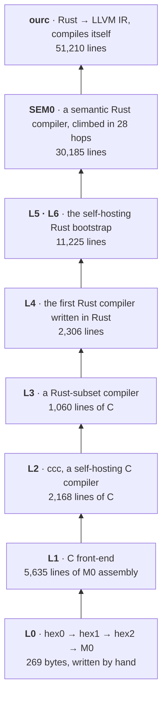

<div align="center">

# ourc

**A Rust compiler grown from 269 bytes of hand-written machine code.**

No downloaded compiler decides what the program is: every compiler is built by the one below it, all the way down
to a seed small enough to read in one sitting. The host's LLVM only turns the final IR into machine code, and is
checked against the hex-built path.


</div>

## The root of trust

This is how the whole thing starts. `hex0` is an ELF binary written byte by byte, with every instruction and jump
offset worked out by hand from the x86-64 manual:

```
# --- code @ 0x400078 ---
31 c0                     # xor  eax, eax            ; read = 0
31 ff                     # xor  edi, edi            ; fd 0
be 0d 01 40 00            # mov  esi, 0x40010d       ; buf = IN
ba 00 00 01 00            # mov  edx, 0x10000        ; count = 64 KiB
0f 05                     # syscall                  ; rax = nbytes read
```

The full seed is 96 lines in [`tower/L0/hex0/hex0.hand.hex`](tower/L0/hex0/hex0.hand.hex). It turns hex text into
bytes, and it rebuilds itself from that file. Everything else in this repository is compiled, rung by rung, from
there. The only binaries taken from the repository are the two hex seeds, hex0 and hex1, and each must rebuild
itself from its commented hex; the Rust driver decodes that hex itself and needs neither. Every compiler and
backend above them is built from source, and the tower's code generator is built twice, by two different compilers,
which must agree byte for byte.

## The tower



| rung | what it is | source |
|---|---|---|
| L0 | hex0, 269 bytes written and commented by hand, then hex1, hex2 and the M0 assembler | `tower/L0` |
| L1 | a C front-end written in M0 assembly | `tower/L1` |
| L2 | `ccc`, a self-hosting C compiler | `tower/L2` |
| L3 | a Rust-subset compiler written in C | `tower/L3` |
| L4 | tier-0, the first Rust compiler written in Rust | `tower/L4` |
| L5, L6 | the self-hosting Rust bootstrap | `tower/L5`, `tower/L6` |
| SEM0 | a semantic Rust compiler | `tower/sem0` |
| ourc | the compiler this repo ships | `ourc/src` |

The backend that turns the tower's IR into x86-64 ELF is built in the tower too (`tower/backend-*`). For ourc's own
machine code, and for one SEM0 build, the host's LLVM is used. It is admitted by result: the LLVM-built SEM0 must
emit byte-identically to the hex-rooted one before it is used.

## Correct, or refused

ourc's promise: **a program it accepts runs exactly as rustc's build of it runs. A program it can't compile
faithfully gets an error, never a wrong answer.**

```
$ cat points.rs
struct Point { x: i32, y: i32 }

fn dist2(p: &Point) -> i32 { p.x * p.x + p.y * p.y }

fn main() {
    let pts = vec![Point { x: 3, y: 4 }, Point { x: 1, y: 1 }];
    let total: i32 = pts.iter().map(dist2).sum();
    println!("sum of squared distances: {}", total);
}

$ ourc points.rs -o points && ./points
sum of squared distances: 27

$ ourc half.rs -o half          # let x: f32 = 1.5;
ourc[O0] half.rs -> error[23..24]: expected `a type other than `f32` (f32 is not implemented; f64 is)`, found `f32`
```

## By the numbers

| | |
|---|---|
| rustc 1.99.1 `tests/ui` tests passed | **10,837** of 20,072 (54%): valid programs compiled correctly, invalid ones rejected |
| wrong answers | **0** of the 3,676 run-pass programs whose output was compared with rustc's |
| valid programs compiled correctly | **2,653** of 7,913, about a third of Rust |
| ourc's own source | **51,210** lines, compiled by itself to a byte-identical fixed point in about 14 s |
| artifacts pinned by sha256 on the way up | **60** |

ourc's strongest areas are control flow, patterns and `match`, lifetimes, structs and enums, traits and generics,
closures, `dyn Trait`, modules and drop order. Its standard library is a small core (`Vec`, `String`, `Option`,
`Result`, `HashMap`, `Box`, `Rc`, iterators and the formatting macros). It refuses `async`, const generics on types,
most of `unsafe` FFI, procedural macros, `f32`, 128-bit integers, and any program with dependencies, so most
real-world crates are out of reach.

- [ourc/REFERENCE.md](ourc/REFERENCE.md): what compiles, feature by feature
- [ourc/LIMITATIONS.md](ourc/LIMITATIONS.md): the promise, how it was measured, and what is out of scope
- [ourc/README.md](ourc/README.md): installing and using ourc

## Verify it yourself

A prebuilt `ourc` is attached to the [v0.1 release](https://github.com/jaredef/ourc/releases/tag/v0.1), with its
`SHA256SUMS`. To check that binary rather than trust it, rebuild it from the hand-written hex.

Needs x86-64 Linux with at least 24 GB of RAM (ourc compiling itself peaks near 20 GB), plus `llc` and `opt` from LLVM
12 or newer and `cc` on `PATH`. One command builds everything from the hand-written hex and checks every artifact
against its pinned hash:

```
bash ourc/release.sh OUT
```

or, with the Rust driver and its live dashboard:

```
cargo run --release --manifest-path ourc/bootstrap/Cargo.toml -- --repo . OUT
```

About 20 minutes later it ends with ourc compiling itself to a fixed point, and this hash:

```
10b9c17a1886a9e063499c544434f370f1c257057562c85dbd9ab03379354144  ourc-v0.1-x86_64-linux/ourc
```

Measured: 19 min 51 s and a 20.8 GB peak on a 16-core Ryzen AI Max+ 395 with 128 GB, using LLVM 22.1.8 and GCC 16.2.1.
Another toolchain builds a different (equally checked) ourc hash. See [ourc/BUILDING.md](ourc/BUILDING.md) for the
toolchain details, where the time and memory go, and the tower's gates.

## Layout

- `tower/`: every rung's source, the build scripts and the gates
- `ourc/`: ourc's crates (`src/`), its runtime and linker (`rt/`), the release and measuring scripts, the test harnesses, and
  `bootstrap/`, the Rust build driver
- `scripts/`: `semc.sh` (SEM0 + LLVM as a compiler) and helpers

Artifact names follow `<rung>.<what>[.<backend>][.gN|.iN]`, for example `L5.rzrs.g2`, `SEM0.h17` and `ourc.g1`.

## License

MIT or Apache-2.0, at your option.
